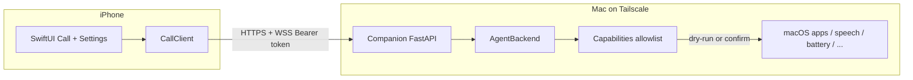

# Architecture — Call my Mac

English technical overview. Product vision: **phone call from iPhone → local Mac agent → control Mac**, with a **pluggable brain** (stub now, local LLM later).

## System context



## Layers

| Layer | Responsibility | Location |
|-------|----------------|----------|
| Presentation | Call UI, mute, hangup, settings | `ios/` |
| Transport | REST session + WebSocket utterances / replies | `protocol/`, `mac/` |
| Agent | Map utterance → reply + proposed actions | `agent/` |
| Capability | Allowlisted system actions (stubs) | `agent/capabilities.py` |
| Brain slot | Stub phrases **or** LocalLLM OpenAI-compat | `StubAgent` / `LocalLLMAgent` |

## Control plane vs media plane

**Phase 0 (now):** control plane only — text utterances over WebSocket/REST.  
**Phase 1:** media plane = WebRTC (preferred) or PCM-over-WS placeholder; STT feeds the same `AgentBackend.chat()`.  
**Phase 2:** swap `StubAgent` → `LocalLLMAgent` without changing transport.  
**Phase 3:** WoL / power orchestration outside the call path.

```
┌─────────────── Call Session ───────────────┐
│  Signaling: start / end / mute / confirm   │
│  Utterances: text (P0) or STT (P1)         │
│  Replies: TTS text + actions[]             │
│  Media (P1+): WebRTC audio tracks          │
└────────────────────────────────────────────┘
```

## Mac Companion (Python)

- **Stack:** Python 3.11+, FastAPI, uvicorn, websockets.
- **Auth:** `Authorization: Bearer <pairing_token>`.
- **Bind:** prefer Tailscale IP (`100.x.y.z`) or `127.0.0.1` for local demo.
- **Endpoints:** see PROTOCOL.md (`/health`, `/v1/session`, `/v1/utterance`, `/v1/ws`, `/v1/confirm`).

## Agent interface (pluggable)

```python
class AgentBackend(Protocol):
    def chat(self, utterance: str, context: AgentContext) -> AgentReply: ...
```

- `AgentReply`: `text`, `actions[]`, `needs_confirmation`, `metadata`.
- `StubAgent`: regex/phrase map → safe intents.
- `LocalLLMAgent`: POST to `OPENAI_COMPAT_BASE/v1/chat/completions`; parse structured JSON into allowlisted intents only.

**Never** execute model-supplied raw shell. Intents must resolve through the allowlist.

## Safety model

```
utterance → agent → Intent(name, args)
                         ↓
              allowlist lookup (fail closed)
                         ↓
         dry_run? ──yes──→ log + return proposed_cmd
              │ no
              ↓
         needs_confirmation? ──yes──→ wait /v1/confirm
              │ no
              ↓
         execute capability stub
```

Default: `CALL_MY_MAC_DRY_RUN=1`.

## iOS sketch

- `CallView`: 打电话 / 挂断 / 静音.
- `SettingsView`: Mac host (Tailscale), pairing token (Keychain later).
- `CallClient`: HTTP + WS client implementing PROTOCOL.md.

Build only on macOS with Xcode; sources here are a skeleton.

## Deployment sketch (later)

```
[iPhone] --Tailscale-- [Mac Companion :8742]
                              |
                     optional LocalLLM :11434
```

Cursor Origin namespace is for future cloud-agent deep work on this repo; not required for Phase 0 local demo.

## Prior art (not the product)

OpenAI / ChatGPT voice & remote-desktop style products are **related prior art**. This scaffold prioritizes **local agent ownership**, **swappable LLM**, and **explicit allowlists**.
